<div align="center">


<br/>

<a href="https://medirag-k33w.onrender.com"></a>

<sub>Free hosting: if nobody has visited for 15 minutes, the first load takes about a minute while it wakes up.</sub>

<br/><br/>

[](https://github.com/himanshugithub360/MediRAG/actions/workflows/ci.yml)     

</div>

> [!CAUTION]
> **Educational project. Not a doctor.** Dr. Insight gives general information only: no diagnoses, no prescriptions.
> In an emergency in India, call **112** (ambulance **108**, mental health **14416**).

<br/>

<p align="center">
  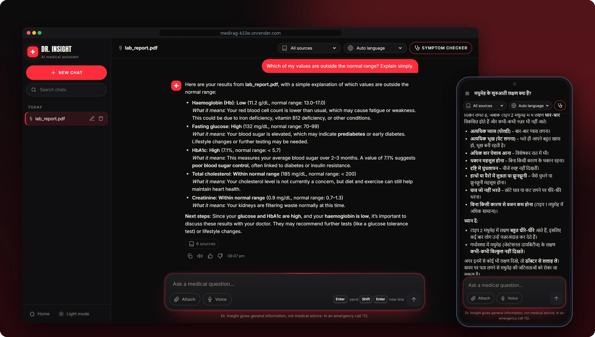
</p>

<p align="center">
  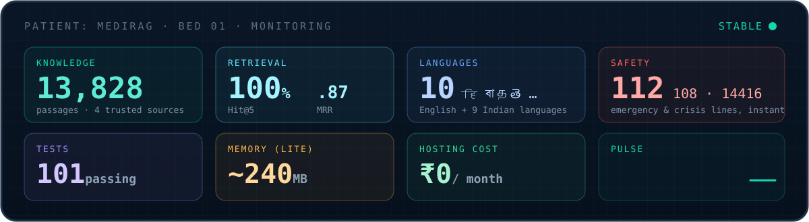
</p>

<div align="center">

**[🩺 Complaint](#-chief-complaint)** &nbsp;·&nbsp; **[🔬 Examination](#-examination)** &nbsp;·&nbsp; **[🧠 Diagnosis](#-diagnosis-how-it-works)** &nbsp;·&nbsp; **[💊 Prescription](#-prescription-run-it-yourself)** &nbsp;·&nbsp; **[🧪 Lab results](#-lab-results)** &nbsp;·&nbsp; **[⚠️ Contraindications](#%EF%B8%8F-contraindications)** &nbsp;·&nbsp; **[🚑 Discharge](#-discharge-deploy-for-free)** &nbsp;·&nbsp; **[📎 Appendix](#-appendix)**

</div>

---

## 🩺 Chief complaint

> *"I searched my symptoms online, and now I'm convinced it's something rare."*

General chatbots answer health questions **confidently but without sources**. They guess when they don't know, and they rarely notice when someone is describing an **emergency**. Most of them only work in English.

**Dr. Insight** takes a different approach:

| | |
|:--|:--|
| 📚 **It reads before it answers** | Every reply is built from passages it retrieved from the *Gale Encyclopedia of Medicine*, OpenStax *Pharmacology*, **MedlinePlus** (U.S. NLM) and **WHO fact sheets**, and the sources are listed under the answer. |
| 🙅 **It says "I don't know"** | If nothing relevant is found, it declines instead of inventing an answer. |
| 🚨 **It knows when to stop talking** | *"My father's face is drooping"* gets **112 / 108 and first-aid steps instantly**, not an essay. |
| 🇮🇳 **It speaks your language** | Ask in Hindi or 8 other Indian languages, by typing or by voice. |

---

## 🔬 Examination

<table>
<tr>
<td width="50%">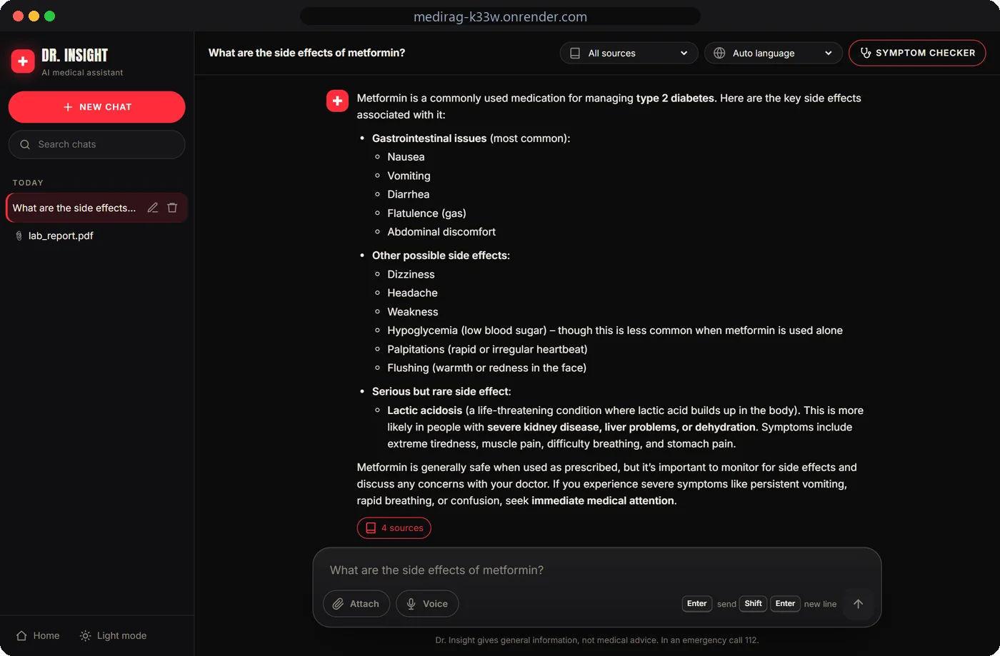</td>
<td width="50%">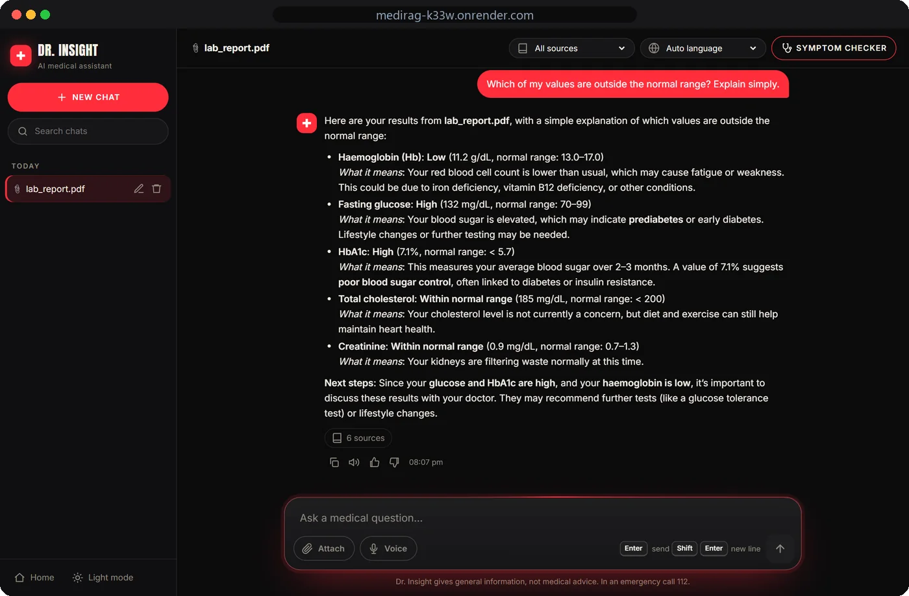</td>
</tr>
<tr>
<td><b>📖 Sourced answers</b><br/><sub>Streamed word by word, in Markdown. Every answer lists its book pages or MedlinePlus/WHO links.</sub></td>
<td><b>📎 Your lab report, explained</b><br/><sub>Upload a PDF or photo. Values are <b>checked against their reference ranges in code</b>, then explained in plain words.</sub></td>
</tr>
<tr>
<td>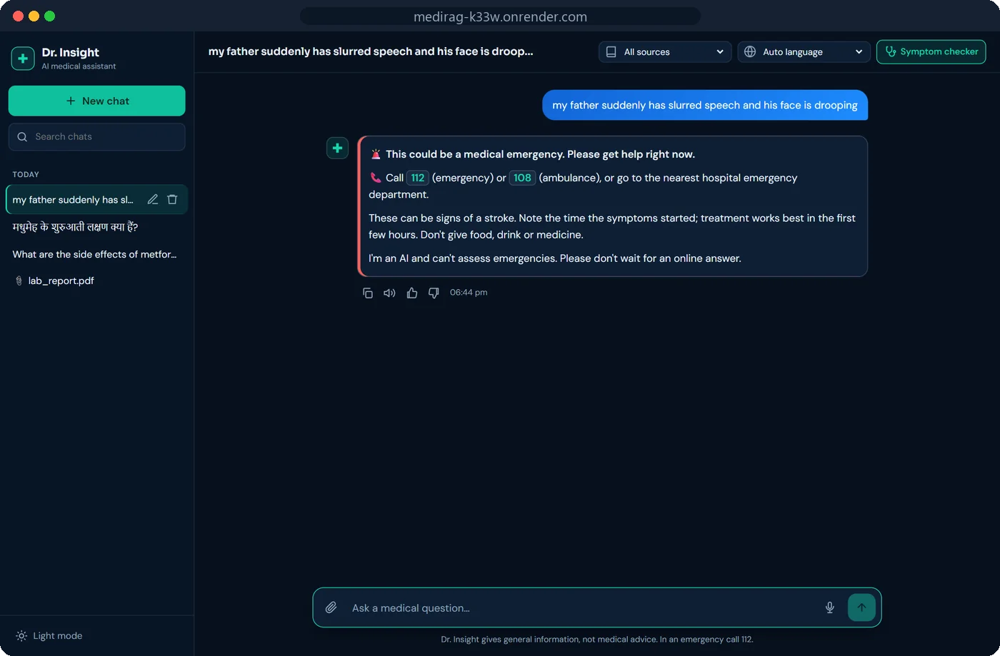</td>
<td>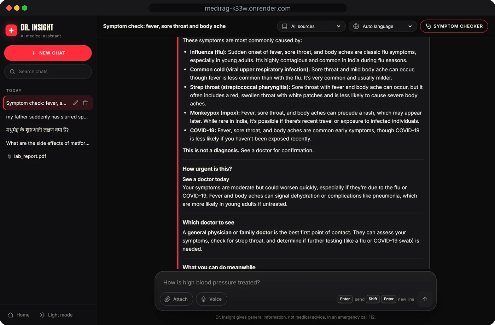</td>
</tr>
<tr>
<td><b>🚨 Emergency detection</b><br/><sub>Safety rules run <b>before</b> the AI, in English, Hindi and Hinglish. Instant, and works even if the AI is down.</sub></td>
<td><b>🩺 Symptom checker</b><br/><sub>Age, duration, severity and warning signs → likely causes, <b>how urgent it is</b> and <b>which doctor to see</b>.</sub></td>
</tr>
<tr>
<td>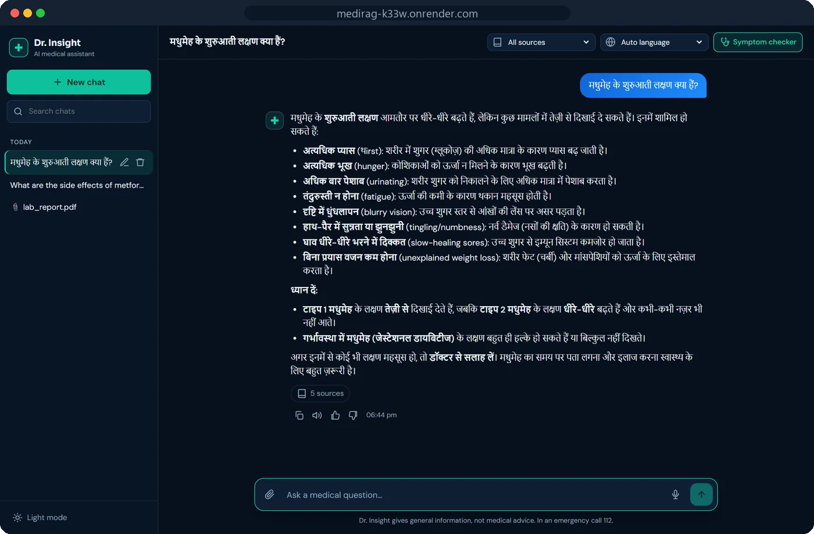</td>
<td>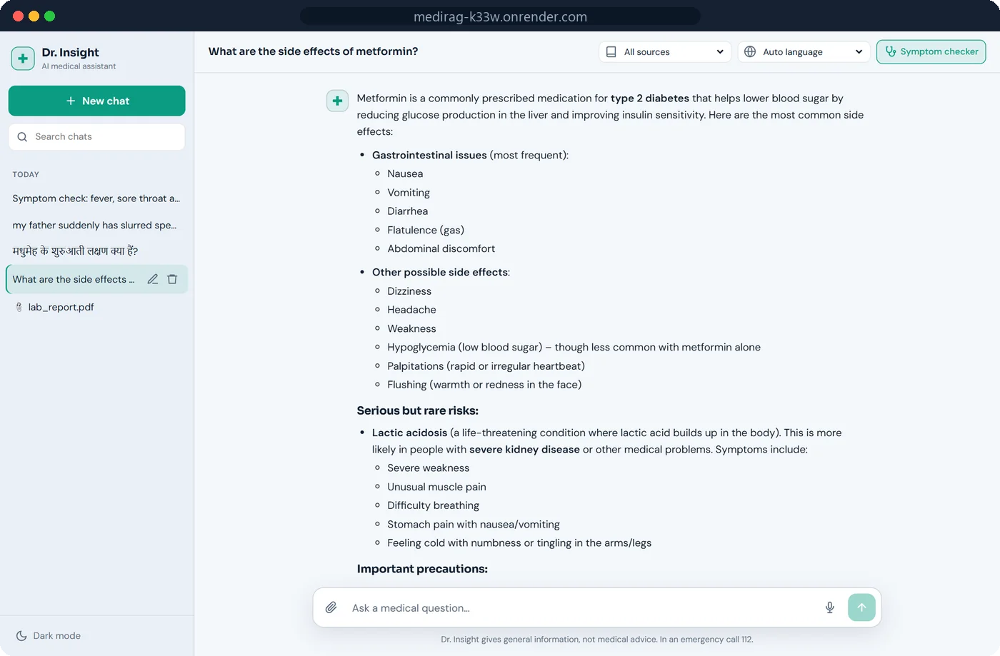</td>
</tr>
<tr>
<td><b>🇮🇳 10 languages + 🎤 voice</b><br/><sub>हिन्दी · বাংলা · मराठी · தமிழ் · తెలుగు · ગુજરાતી · ಕನ್ನಡ · മലയാളം · ਪੰਜਾਬੀ. Speak your question, hear the answer.</sub></td>
<td><b>🌗 A real app</b><br/><sub>Saved chat history, search, rename, 👍/👎 feedback, copy, Stop button, dark and light themes.</sub></td>
</tr>
</table>

<p align="center">
  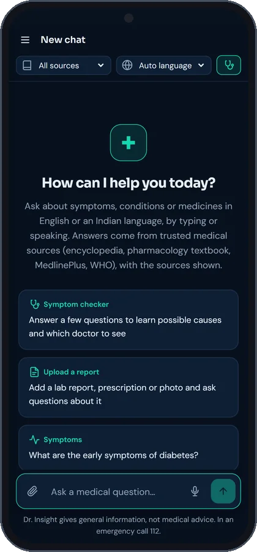&nbsp;&nbsp;
  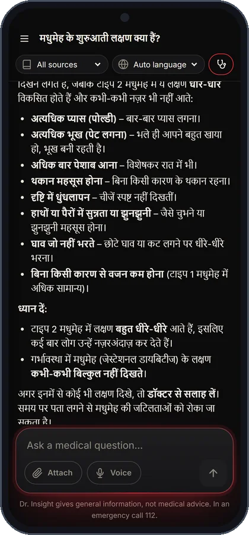&nbsp;&nbsp;
  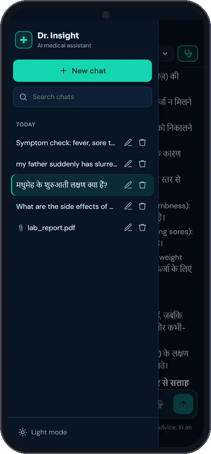
  <br/><sub>📱 Fully responsive: the same app on a phone</sub>
</p>

<details>
<summary><b>Everything it can do</b> (full list)</summary>

<br/>

| Area | Features |
|---|---|
| **Answers** | RAG over 13,828 passages · hybrid vector + BM25 search · cross-encoder reranking · sources with page numbers or links · filter by source · follow-up questions understood in context · instant replies to greetings |
| **Safety** | Emergency, crisis and dosage rules (English, Hindi, Hinglish) · "won't guess" threshold · no doses, prescriptions or diagnoses · per-visitor rate limits, with emergencies never blocked |
| **India** | 10 languages, detected automatically from the script · Indian helplines (112, 108, Tele-MANAS 14416) · symptom checker that favours common local causes |
| **Your files** | Text and scanned PDFs, photos (Pixtral vision) · range checking done in code · image disclaimers · files deleted along with their chat |
| **App** | Streaming · Markdown · SQLite history · search, rename, delete · 👍/👎 review page · copy · dark/light theme · mobile · voice in and out |
| **Engineering** | 101 tests · GitHub Actions · Docker (full and lite) · waitress/gunicorn · free Render deploy · retrieval evaluation script · all settings in one file |

</details>

---

## 🧠 Diagnosis: how it works

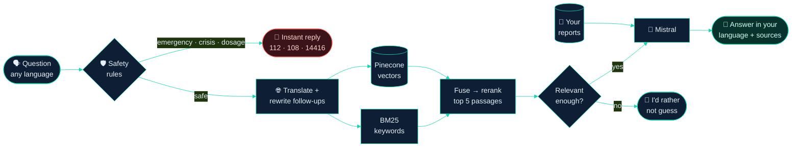

| | Stage | In one line |
|:-:|---|---|
| ① | **Ingest** · `fetch_sources.py`, `store_index.py` | Books + MedlinePlus + WHO → cleaned 1000-character chunks → `all-MiniLM-L6-v2` vectors in Pinecone, plus a local keyword index |
| ② | **Guard** · `src/safety.py` | Emergency, crisis and dosage rules run on the original text **and** on a faithful English translation |
| ③ | **Retrieve** · `src/retrieval.py` | Vector search (meaning) + BM25 (exact drug names) → fused → cross-encoder picks the best 5 |
| ④ | **Answer** · `app.py` | Mistral writes from those passages and your uploads, in your language, streamed, with sources |

**Stack:** Flask · LangChain · Pinecone · Mistral + Pixtral · sentence-transformers · ONNX Runtime · SQLite · vanilla JS · Web Speech API · Docker · GitHub Actions · Render

---

## 💊 Prescription: run it yourself

```text
℞  Dr. Insight, local setup                          Refills: unlimited · Cost: ₹0
   You need: Python 3.12 · a free Pinecone key · a free Mistral key · ~2 GB of disk
```

**℞ 1 · Install**

```bash
git clone https://github.com/himanshugithub360/MediRAG.git
```
```bash
cd MediRAG
```
```bash
py -3.12 -m venv .venv
```
```bash
.venv\Scripts\activate
```
```bash
pip install torch --index-url https://download.pytorch.org/whl/cpu
```
```bash
pip install -r requirements.txt
```

<sub>macOS/Linux: `python3.12 -m venv .venv` and `source .venv/bin/activate`.</sub>

**℞ 2 · Add your keys**: create `.env` in the project folder ([Pinecone](https://app.pinecone.io) · [Mistral](https://console.mistral.ai/api-keys), both free):

```env
PINECONE_API_KEY=your-pinecone-key
MISTRAL_API_KEY=your-mistral-key
FLASK_SECRET_KEY=any-long-random-string
```

**℞ 3 · Build the knowledge base** (once). Put `Gale Encyclopedia of Medicine. Vol. 1. 2nd ed.pdf` (your own copy) and the free [OpenStax *Pharmacology for Nurses*](https://assets.openstax.org/oscms-prodcms/media/documents/Pharmacology-WEB.pdf) PDF in `Data/`, then:

```bash
python fetch_sources.py
```
```bash
python store_index.py
```

<sub>About 5 minutes to download MedlinePlus + WHO, then about 12 minutes to embed and upload 13,828 chunks on a laptop CPU.</sub>

**℞ 4 · Start**

```bash
python app.py
```

→ **<http://localhost:8080>** opens by itself. For a production server, use `python serve.py`.

<details>
<summary><b>Dosage notes</b>: browser choice, ports, lite mode, other PDFs, licences</summary>

<br/>

| Command / setting | Effect |
|---|---|
| `python app.py --browser chrome` · `edge` · `none` | Choose the browser (or set `OPEN_BROWSER` in `.env`) |
| `python serve.py` | Production server (waitress, 8 threads, still streams) |
| `set RETRIEVER=lite&& python serve.py` | Lite mode, as on Render (`pip install -r requirements-lite.txt` first) |
| `PORT=5000` · `HOST=0.0.0.0` | Another port · allow other devices on your network |
| `FLASK_DEBUG=1` | Auto-reload (always kept on `127.0.0.1`) |

- **Any** PDF in `Data/` is indexed. Give it a nice title in `SOURCE_TITLES` (`src/config.py`). Other Gale volumes are copyrighted, so add them only if you own them.
- **Licences:** MedlinePlus is U.S. government content ([terms](https://medlineplus.gov/about/using/usingcontent/)); WHO fact sheets are CC BY-NC-SA 3.0 IGO (non-commercial, with attribution).

</details>

---

## 🧪 Lab results

### Retrieval

Measured with `python eval_retrieval.py` on 16 test questions. It makes no LLM calls, so it's free to run.

| Setup | Hit@5 | MRR | |
|---|:-:|:-:|---|
| Original: 300-char chunks, one book, vectors only | 56% | 0.52 | `█████▏    ` |
| 1000-char chunks, 4 sources, vectors | 100% | 0.81 | `████████  ` |
| + BM25 hybrid search | 100% | 0.81 | `████████  ` |
| **+ cross-encoder rerank (full mode)** | **100%** | **0.87** | `████████▋ ` |
| Lite mode (Render): hosted rerank | 100% | 0.82 | `████████▏ ` |

<sub>Hit@5: a relevant passage is in the top 5. MRR: 1.0 means it's always ranked first. Keyword matching is a rough judge, so use these to compare setups, not as absolute accuracy.</sub>

### Tests

**101 tests, about 5 seconds, with no API keys or network** (the AI is faked in `tests/conftest.py`). [GitHub Actions](.github/workflows/ci.yml) runs them and builds both Docker images on every push.

```bash
pip install -r requirements-dev.txt
```
```bash
python -m pytest -q
```

| Suite | | Covers |
|---|:-:|---|
| `test_app.py` | 29 | `/chat`, streaming, greetings, follow-ups, Hindi, filters, safety paths, **error handling** (LLM down, 429 retry, rate limit, bad input), symptom checker, uploads, **lab range checks**, privacy, feedback, health |
| `test_safety.py` | 58 | Emergencies, crises, dosage, notices, safe questions, Hindi and Hinglish |
| `test_storage.py` · `test_retrieval_lite.py` · `test_languages.py` | 6 · 5 · 3 | Saved chats · hosted rerank and its fallback · script detection |

---

## ⚠️ Contraindications

Every message passes [`src/safety.py`](src/safety.py) **before** the AI sees it:

| If the patient says… | Dr. Insight responds with |
|---|---|
| *"My dad is having chest pain"* · *"मेरे पिता को सीने में दर्द हो रहा है"* | 🚨 **112 / 108** + first-aid steps, instantly |
| *"I want to end my life"* | 💙 **Tele-MANAS 14416** (free, 24×7) + 112 |
| *"How much paracetamol should I take?"* | 💊 A polite refusal; ask a doctor or pharmacist |
| *"What are the signs of a heart attack?"* | ℹ️ A normal answer + *"if this is happening now, call 112"* |
| *"What's the capital of France?"* | 🙅 *"I'd rather not guess"* |

**Known limitations, stated honestly:**

- The safety rules use **keywords**: fast and predictable, but unusual wording can slip through or trigger by mistake.
- A small free LLM can still **phrase things imperfectly**. Lab values are range-checked in code for exactly this reason.
- Photo descriptions from the vision model can be wrong, so every image answer carries a warning.
- The free demo **forgets chats** when it restarts, and visitors share a monthly AI quota.

<details>
<summary><b>How the rules decide</b></summary>

<br/>

- **"Happening now" vs. a general question:** the message must describe someone experiencing the symptom (*"I'm…"*, *"my mother has…"*) or be urgent (*"right now"*, *"help"*). The past, prevention and risk don't count. When unsure, the rules lean towards showing help.
- **"Won't guess" cut-offs**, set from measured scores. Full mode: real questions scored **+1.3 to +8.8**, off-topic ones **−10.9 to −8.4** → cut-off **−1.0**. Lite mode: **0.82–1.0** vs **≤ 0.04** → cut-off **0.2** (cosine 0.45 when the free reranks run out).
- **Rate limits:** 10 messages/min and 100/day per visitor; emergencies are never limited. Mistral calls are spaced 1.1 s apart.
- **Emergency numbers** default to India; change them in `.env`.

</details>

---

## 🚑 Discharge: deploy for free

Live at **[medirag-k33w.onrender.com](https://medirag-k33w.onrender.com)** on Render's free tier: **₹0, no credit card.**

> [!NOTE]
> Render's free tier has **512 MB RAM and 0.1 CPU**, too small for PyTorch. So it runs **lite mode** ([`src/retrieval_lite.py`](src/retrieval_lite.py)): the **same** embedding model through ONNX (identical vectors, no re-index), Pinecone search and Pinecone's **hosted reranker** (500 free per month, then vector order). **~240 MB RAM · MRR 0.82**, with every feature intact.

1. Sign up at **[dashboard.render.com](https://dashboard.render.com/register)** with GitHub.
2. **New + → Blueprint** → choose this repo. Render reads [`render.yaml`](render.yaml).
3. Paste `PINECONE_API_KEY` and `MISTRAL_API_KEY` (the secret key is generated for you).
4. **Deploy.** It's live in about 10 minutes, and every push to `main` **redeploys once CI passes**.

<details>
<summary><b>Free-tier side effects</b> · <b>Docker</b></summary>

<br/>

- Sleeps after 15 idle minutes (about 1 minute to wake up) · chats and uploads reset on restart · 500 hosted reranks per month · visitors share your Mistral quota (the rate limit protects it).

| Image | For | RAM |
|---|---|---|
| [`Dockerfile`](Dockerfile) | Full quality on your own machine | ~2 GB |
| [`Dockerfile.render`](Dockerfile.render) | Free hosting (lite) | ~240 MB |

```bash
docker build -t medirag .
```
```bash
docker run --rm --env-file .env -p 7860:7860 medirag
```

Then open <http://localhost:7860>. `GET /healthz` returns `ok` when it's ready; add `-v medirag-data:/app/instance` to keep chats. API keys are never baked into the images.

</details>

---

## 📎 Appendix

<details>
<summary><b>A · API</b></summary>

<br/>

| Endpoint | Purpose |
|---|---|
| `POST /api/chat/stream` | Ask; answer streams as SSE: `conversation` → `token`… → `done` / `error` |
| `POST /chat` | Ask; the full answer as JSON |
| `POST /api/symptom-check/stream` | `symptoms`*, `age`, `sex`, `duration`, `severity`, `conditions`, `medicines`, `red_flags[]` |
| `POST /api/uploads` | Multipart `file` (+ `conversation_id`, `language`) |
| `GET /api/attachments/<id>/file` | View an upload (owner only) |
| `GET` · `PATCH` · `DELETE /api/conversations[/<id>]` | List, read, rename, delete |
| `POST /api/messages/<id>/feedback` | `{"value": 1 \| -1 \| null}` |
| `GET /api/feedback/summary` | 👍/👎 totals + recent 👎 (localhost only) |
| `GET /healthz` | `ok` once the models are loaded |

```bash
curl -X POST http://localhost:8080/chat -H "Content-Type: application/json" -d "{\"message\": \"What causes migraines?\"}"
```

Request: `message` + optional `conversation_id`, `language` (`auto`, `en`, `hi`, `bn`, `mr`, `ta`, `te`, `gu`, `kn`, `ml`, `pa`) and `collections` (`encyclopedia`, `pharmacology`, `medlineplus`, `who`). The response includes `response`, `sources[{title, page, url}]`, `notice`, `language` and `kind` (`emergency`, `crisis`, `dosage`, `low_confidence`, `symptom_check`, `error` or `rate_limited`, which comes with HTTP 429).

</details>

<details>
<summary><b>B · Configuration</b> (everything lives in <code>src/config.py</code>; <i>(env)</i> settings can go in <code>.env</code>)</summary>

<br/>

| Variable | Default | Purpose |
|---|---|---|
| `PINECONE_API_KEY` · `MISTRAL_API_KEY` | (required) | API access |
| `FLASK_SECRET_KEY` | saved in `instance/` | Signs the cookie that links a browser to its chats |
| `MISTRAL_MODEL` · `MISTRAL_VISION_MODEL` | `open-mistral-nemo` · `pixtral-12b-2409` | Answer and image models |
| `RETRIEVER` · `RERANK_MODEL` | `full` · `bge-reranker-v2-m3` | Full or lite mode · hosted reranker (lite) |
| `MIN_RELEVANCE_SCORE` · `MIN_RERANK_SCORE` · `MIN_VECTOR_SCORE` | `-1.0` · `0.2` · `0.45` | "Won't guess" cut-offs |
| `CHAT_RATE_LIMIT` · `UPLOAD_RATE_LIMIT` | `10 per minute;100 per day` · `5 per minute;30 per day` | Per visitor |
| `MISTRAL_MIN_INTERVAL` · `MAX_UPLOAD_MB` | `1.1` · `10` | Seconds between AI calls · largest upload |
| `EMERGENCY_NUMBER` · `AMBULANCE_NUMBER` · `MENTAL_HEALTH_HELPLINE` | `112` · `108` · `14416` | Helplines shown |
| `HOST` · `PORT` · `FLASK_DEBUG` · `OPEN_BROWSER` | `127.0.0.1` · `8080` · off · `default` | Local server |
| `TRUST_PROXY` · `CROSS_SITE_COOKIES` | off · off | Behind a hosting proxy · embedded in an iframe |
| `CHUNKS_FROM_PINECONE` · `INSTANCE_DIR` · `PINECONE_NAMESPACE` | on · `instance/` · `medical_v2` | Keyword index · data folder · namespace |

Code-level tuning: `CHUNK_SIZE`/`CHUNK_OVERLAP` (1000/150, rebuild after changing), `CANDIDATES_PER_RETRIEVER`/`FINAL_K` (20/5), `VECTOR_WEIGHT` (0.6), `MAX_HISTORY_MESSAGES` (8), `LLM_TEMPERATURE` (0.2). The persona and prompts are in `app.py`.

</details>

<details>
<summary><b>C · Project structure</b></summary>

<br/>

```
MediRAG/
├── app.py                 # Flask app: RAG pipeline, streaming, uploads, history, feedback
├── serve.py · wsgi.py     # Production servers (waitress · gunicorn)
├── store_index.py         # Build the knowledge base → Pinecone + keyword index
├── fetch_sources.py       # Download MedlinePlus + WHO
├── eval_retrieval.py      # Measure retrieval (eval/questions.json)
├── src/
│   ├── config.py          # every setting
│   ├── retrieval.py       # full: hybrid search + cross-encoder
│   ├── retrieval_lite.py  # lite: ONNX + Pinecone + hosted rerank
│   ├── safety.py          # emergency / crisis / dosage rules
│   ├── documents.py       # uploads + lab range checks
│   ├── languages.py       # 10 languages
│   ├── storage.py         # SQLite
│   └── helper.py · launcher.py
├── templates/chat.html    # the whole UI
├── static/ · docs/assets/ # icons, vendored JS · README images
├── tests/                 # 101 tests
└── Dockerfile · Dockerfile.render · render.yaml · .github/workflows/ci.yml
```

</details>

<details>
<summary><b>D · Troubleshooting</b></summary>

<br/>

| Symptom | Treatment |
|---|---|
| `Missing environment variables` | `.env` is missing, misnamed (`.env.txt`) or in the wrong folder |
| *"I'm having trouble processing that request"* | Check the terminal; usually a Mistral `403` (set `MISTRAL_MODEL=open-mistral-nemo`) or `429` (slow down) |
| `Index 'medichatbot' not found` / empty answers | Run `python store_index.py` |
| `ModuleNotFoundError` · huge PyTorch download | Activate `.venv` · install the CPU build (℞ 1) |
| Install fails on Python 3.13+ | Use Python 3.12 |
| Port 8080 busy | `PORT=5000` in `.env` |
| Real question → *"I'd rather not guess"* | Name the condition or medicine, or lower `MIN_RELEVANCE_SCORE` (e.g. `-3`) |
| No 🎤 / mic blocked · Hindi not read aloud | Use Chrome/Edge and allow the mic · use Edge, or install a Hindi voice |
| Hinglish answered in English | Choose **हिन्दी** in the language menu |
| Chat history gone | Cookies cleared, private window, or another browser |
| Render never goes **Live** | Check **Logs**: usually a wrong API key → fix it under **Environment** → **Manual Deploy** |
| Render didn't redeploy | It waits for CI; look for a red ❌ under **Actions** |

</details>

---

<div align="center">


**[github.com/himanshugithub360](https://github.com/himanshugithub360)**

<sub>Signed and discharged in good health. ⚕️ Not medical advice: in an emergency, call 112.</sub>

</div>
